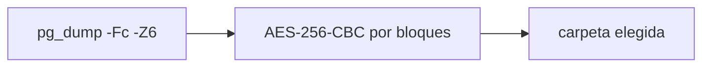

# Solo el markdown de planeación

No se crea la aplicación WinForms ni ningún otro código. El único archivo nuevo es [docs/planeacion-respaldo-windows.md](docs/planeacion-respaldo-windows.md), con la planeación siguiente.

# Respaldo de la base desde Windows

Aplicación nueva en `tools/respaldo`, aparte de Spring. .NET 8 ya está en esta máquina (no hace falta Python ni 7-Zip). `pg_dump` no está instalado en Windows: el programa usa el `pg_dump` de la imagen `postgres:18-alpine` de `compose.yaml` y, si aparece un `pg_dump` local, lo prefiere.

PostgreSQL no cifra el dump. El archivo se comprime con el formato custom de `pg_dump` (`-Fc -Z6`, que ya va comprimido y se restaura con `pg_restore`) y después se cifra en el mismo flujo con la contraseña de conexión.

## Ventana

- Conexión: host, puerto, base, usuario y contraseña. Al abrir, rellena desde `.env` (`POSTGRES_PORT`, `SPRING_DATASOURCE_USERNAME`, `SPRING_DATASOURCE_PASSWORD`, base `mydb`).
- Carpeta de respaldo, con botón para elegirla.
- Casilla “Cifrar con la contraseña de PostgreSQL”, activada por defecto.
- Programación: activar y hora. Registra o quita una tarea del Programador de tareas de Windows (`Tancol respaldo de base`) que llama al mismo programa con `--backup`, sin abrir la ventana.
- Botón “Respaldar ahora” y una línea de estado (archivo escrito o el error).

La configuración queda en `%AppData%\TancolRespaldo\config.json`. La contraseña no se guarda en texto plano: se protege con DPAPI del usuario de Windows, así la tarea programada puede correr sin pedirla. La tarea tiene que ser del mismo usuario.

## Archivo

Nombre: `{base}_{yyyyMMdd_HHmmss}.dump.enc` (sin cifrar, `{base}_{yyyyMMdd_HHmmss}.dump`).

Flujo, sin cargar el dump en memoria:

- Lee la salida de `pg_dump` en bloques de 1 MB y la cifra al vuelo hacia la carpeta destino.
- Clave: PBKDF2-SHA256 de la contraseña de PostgreSQL. El archivo lleva sal, IV y HMAC para poder descifrarlo después con esa misma contraseña.
- Si el cifrado está apagado, escribe el `.dump` comprimido tal cual.
- Si el proceso falla, borra el archivo a medias.

Origen de `pg_dump`, en este orden: `pg_dump` del PATH, luego `docker exec` al contenedor `postgres` de este compose (`pg_dump -U ... -d mydb -Fc -Z6`). La contraseña de conexión va por `PGPASSWORD` en el proceso, no en la línea de comandos.

## Qué no incluye

No hay pantalla de restauración. El formato queda descrito para descifrar el `.enc` y pasarlo a `pg_restore`.
